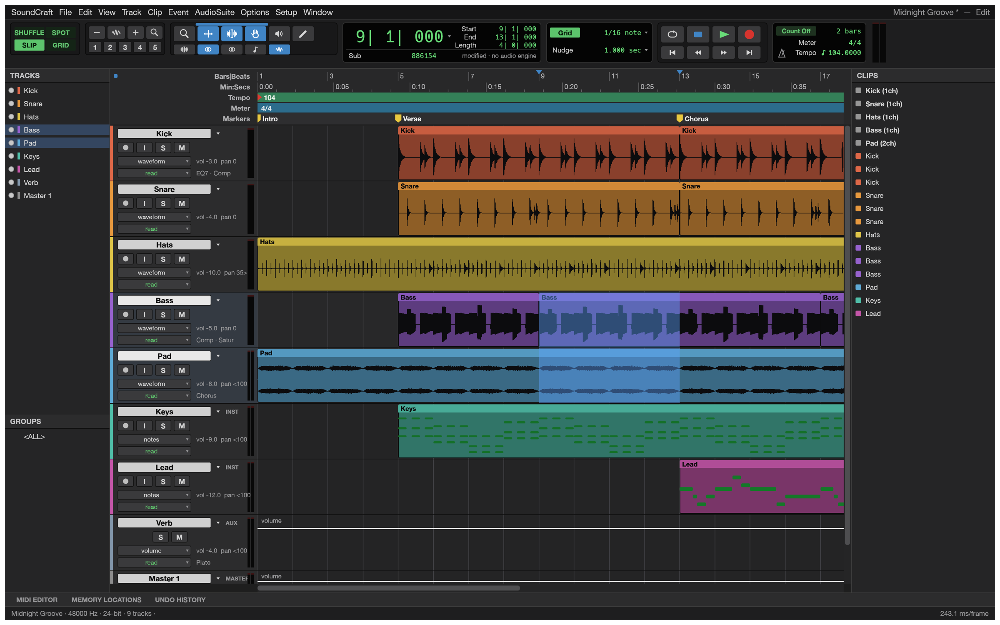
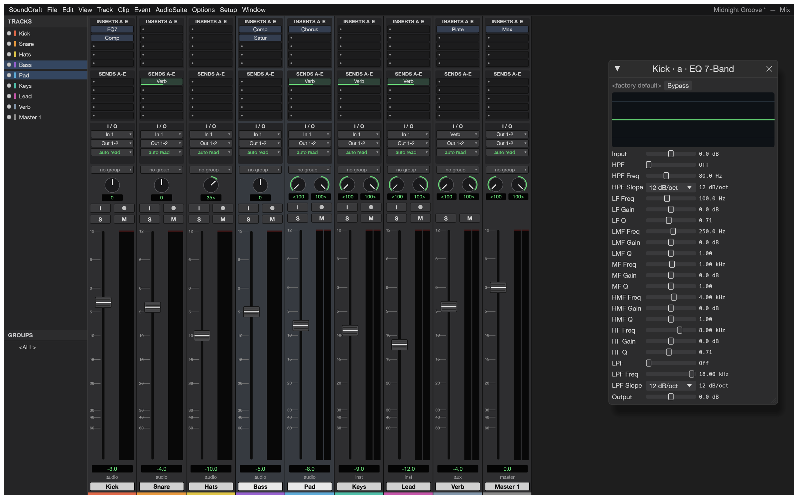

<p align="center">
  <a href="../../releases">
    <picture>
      <source media="(prefers-color-scheme: dark)" srcset="docs/brand/artcraft-logo-white.svg">
      
    </picture>
  </a>
</p>

<h1 align="center">SoundCraft</h1>

<p align="center">
  <b>Recording, editing and mixing audio; an open-source, clean-room reimplementation of Avid Pro Tools, rebuilt in pure Rust.</b>
</p>

<p align="center">
  A complete digital audio workstation that runs natively on macOS, Windows, Linux and FreeBSD, and
  in the browser. Multitrack editing, a full mixer with plugins, sends and automation, MIDI, recording
  and bouncing, and every action scriptable from the command line or by an AI agent.
</p>

<p align="center">
  
  
  
  
  
</p>

<p align="center">
  
  <br>
  <sub>The Edit window: tracks, waveforms, MIDI, rulers, markers and the transport, playing the built-in demo song (every sound in it is synthesised by SoundCraft itself).</sub>
</p>

## What it does

SoundCraft follows the workflow audio engineers already know: an **Edit window** for arranging and
editing, a **Mix window** for balancing, edit modes, tools, playlists, memory locations, AudioSuite
processing and the rest. If you've spent years in that workflow, your hands should already know
where things are.

<table>
  <tr>
    <td width="50%"></td>
    <td width="50%"></td>
  </tr>
  <tr>
    <td><b>Mix window.</b> Ten inserts and ten sends per track, busses and aux inputs, master faders, VCAs, routing folders, solo-in-place with implicit solo, and meters with peak hold.</td>
    <td><b>MIDI editor.</b> Instrument tracks with built-in synths, a piano roll with a velocity lane, step input, quantize, transpose, and Standard MIDI File import and export.</td>
  </tr>
  <tr>
    <td width="50%"></td>
    <td width="50%"></td>
  </tr>
  <tr>
    <td><b>Automation and markers.</b> Breakpoint automation for volume, pan, mute, sends and every plugin parameter, written live in Write, Touch and Latch, plus memory locations and a big counter.</td>
    <td><b>Everywhere.</b> Signed builds for macOS (universal), Windows (x64, x86, Arm), Linux (AppImage, deb, rpm, Flatpak), FreeBSD, and a WebAssembly build that runs in the browser.</td>
  </tr>
  <tr>
    <td width="50%"></td>
    <td width="50%"></td>
  </tr>
  <tr>
    <td><b>Video.</b> A picture track with thumbnails and a Video window that follows the playhead, decoding H.264, ProRes and Motion JPEG in pure Rust, with timecode burn-in and sync offset.</td>
    <td><b>Surround and immersive.</b> Main and bus formats from stereo to 9.1.6 and Ambisonics, a surround panner with divergence and height, object/bed routing and a Renderer window with live speaker levels.</td>
  </tr>
  <tr>
    <td width="50%"></td>
    <td></td>
  </tr>
  <tr>
    <td><b>Notation.</b> A Score Editor for MIDI tracks, MusicXML export for Sibelius and other notation programs, and printable engraved scores.</td>
    <td><b>Your plugins too.</b> CLAP, VST3 and Audio Units, with their own editors, their state saved in the session, and every instance created off the audio thread.</td>
  </tr>
</table>

### Feature tour

- **Editing:** Shuffle, Slip, Spot and Grid modes; Smart, Selector, Grabber, Trim, Pencil, Zoom and
  Scrubber tools; cut, copy, paste, duplicate, repeat, shift, insert silence, separate (at
  selection, on grid, at transients), heal, consolidate, strip silence, nudge; fades and
  crossfades in five shapes, drawn straight from the clip corners; playlists with comping lanes;
  clip gain lines; edit groups; single-key Commands Focus shortcuts; undo for everything.
- **Mixing:** fader and pan with automation, pre/post sends, busses, aux inputs, master faders,
  VCA masters, routing folders, solo modes, mute and solo groups, phase invert and trim, clip
  effects, and automatic plugin delay compensation.
- **Automation:** volume, pan, mute, send and every plugin parameter; Write, Touch, Latch and
  Trim passes recorded live from the faders; thin, glide, coalesce and convert to clip gain.
- **Plugins:** 7-band and 1-band EQ, compressor/limiter, expander/gate, de-esser, maximizer,
  channel strip, room and plate reverbs, mod delay, chorus, flanger, phaser, saturator, lo-fi,
  rectifier, pitch shifter, time shift, gain, trim, invert, DC removal, signal generator, dither,
  a subtractive synth and a drum synth, all original. **CLAP plugins** load too. Any processor
  runs offline as AudioSuite, and user presets save per plugin.
- **MIDI:** instrument and MIDI tracks, a piano-roll MIDI editor with a velocity lane, an event
  list, a score view, step input, quantize, transpose, real-time properties, Standard MIDI Files,
  and Audio-to-MIDI from a sung or played melody.
- **Recording:** punch in on a selection or on the fly, pre/post-roll, loop recording with a
  playlist per take, input monitoring through the full channel strip, and autosave with recovery.
- **Time and tempo:** Bars|Beats, Min:Secs, Timecode (every rate, drop-frame included),
  Feet+Frames and Samples; tempo and meter maps with a tempo editor; linear, parabolic and
  S-curve tempo ramps; key signatures and detected chords; Beat Detective and Identify Beat;
  pitch-preserving Elastic warping.
- **Audio files:** WAV/BWF/RF64, AIFF/AIFC and FLAC in and out; MP3, Ogg Vorbis, AAC, ALAC, CAF
  and the audio of MP4/MOV movies in. Any sample rate and bit depth.
- **Bounce:** mix or stems to WAV, AIFF or FLAC at 16/24/32-bit float with dither and
  normalisation, reporting peak, true peak and integrated loudness (LUFS).
- **Fast:** a parallel mix engine, copy-on-write undo, and a UI that holds 120 frames per second
  with seventy-odd tracks playing.

## Getting started

[View all releases](../../releases)

| Platform | Download | Run |
|----------|----------|-----|
| **Windows x64** | [soundcraft-x64.7z](../../releases) | Run installer → launch `soundcraft-x64.7z` |
| **Linux x64** | [soundcraft-Linux-x64.run](../../releases) | `chmod +x` → run installer |
| **macOS Apple Silicon** | [soundcraft-macOS-arm64.dmg](../../releases) | Open DMG → drag to Applications |


### Logs

The desktop app writes its `log` records to standard error and to `logs/soundcraft.log` in the
settings directory, beside `ui.json`, `Autosave/` and `Presets/` (Linux `~/.config/soundcraft/logs/`,
or `$XDG_CONFIG_HOME/soundcraft/logs/`; macOS `~/Library/Application Support/SoundCraft/logs/`;
Windows `%APPDATA%\SoundCraft\logs\`). A start from a desktop menu or the Dock has no terminal, so
this file is what to attach to a bug report: the engine's panic report, audio devices that failed to
open or broke, plugins that refused their stored state, CLAP plugins' own messages and files that
failed to open land there. Each launch moves the previous log to `soundcraft.1.log` (and that one to
`soundcraft.2.log`), so the log of a run that crashed survives the next start. The file stops
growing at 16 MiB. `--version` writes no file, and runs with `SOUNDCRAFT_NO_PREFS` log to standard
error only.

| Variable | Effect |
|---|---|
| `RUST_LOG` | Log levels for standard error and the log file. Default: `info` for SoundCraft's own crates, `warn` for everything else. env_logger-style directives replace that, e.g. `RUST_LOG=debug`, `RUST_LOG=warn,soundcraft_mix=trace` or `RUST_LOG=info,wgpu_core=warn`; a directive ending in `*` covers every target starting with it (`soundcraft*=debug`). |
| `SOUNDCRAFT_NO_PREFS` | No preferences read or written and no log file (agents' test runs). |

The realtime audio thread never writes a record itself: the logger keeps the first one it logs
(without waiting or allocating), counts the rest, and the UI thread writes them. The logger is
`apps/soundcraft/src/logging.rs`. The web app logs to the browser console instead.

## For agents and scripts

Everything you can click is also a command with an id and JSON parameters, and the same commands
are reachable from the menus, the keyboard, the command line, a JSON control channel and an
[MCP](https://modelcontextprotocol.io) server. Programmatic calls never open dialogs, and
`session.inspect` reports exactly what changed, so an agent can check its own work.

```sh
# Headless: load the demo, turn the kick down, add an EQ, bounce.
soundcraft-cli run --demo \
  --cmd 'mix.volume={"track":"Kick","db":-6}' \
  --cmd 'mix.insert={"track":"Bass","plugin":"eq_7band"}' \
  --bounce mix.wav

# Drive the running app.
soundcraft --demo --control 7801 &
soundcraft-cli app --port 7801 transport.play
soundcraft-cli app --port 7801 ui.screenshot '{"path":"shot.png"}'

# Give Claude a DAW.
claude mcp add soundcraft -- soundcraft-cli mcp --demo
```

See [`docs/control-protocol.md`](docs/control-protocol.md) and [`docs/mcp.md`](docs/mcp.md).
`soundcraft-cli commands` lists every command.

Open **SoundCraft › Session Audio Health** to check loaded audio availability, sample-rate
mismatches and clip source bounds across all playlists, including alternate takes. The report
offers a refresh button and suggests how to resolve each issue. Scripts can obtain the same JSON
report with `soundcraft-cli run --demo --cmd 'session.audio_health={}'`. This checks loaded media,
not files on disk, signal levels, plugins or routing.

## How it's built

SoundCraft is a Cargo workspace of small crates with strict layering: nothing below the UI knows
about egui, so the interface could be swapped for another one.

| Crate | What it does |
|---|---|
| `soundcraft-time` | Timebases, tempo and meter maps, timecode, grid |
| `soundcraft-audio-io` | Audio file formats and waveform overviews |
| `soundcraft-midi` | Standard MIDI Files and MIDI operations |
| `soundcraft-dsp` | Plugins, offline processing, meters, loudness, FFT |
| `soundcraft-model` | The session document |
| `soundcraft-mix` | The mix engine (realtime and offline share it) |
| `soundcraft-engine` | Commands, undo, editing, import/export, bounce |
| `soundcraft-playback` | Audio devices (CoreAudio, WASAPI, ALSA, WebAudio) and recording |
| `soundcraft-automation` | MCP server and control-channel client |
| `soundcraft-ui-egui` | The user interface |

The code never panics on bad input: errors are values, and a malformed file or a bad agent call
produces a message, never a crash. `cargo xtask ci` runs formatting, clippy, the tests, the asset
and layering checks and the WebAssembly build.

## Status and roadmap

SoundCraft is **pre-alpha**: it covers 94 % of the incumbent's menu items (measured), about 70 % of
its features by presence, and is roughly 40 % of the way to replacing it for real work: record,
edit, mix and bounce work end to end, but choosing an audio interface and buffer size,
recording MIDI from a controller and session interchange (AAF/OMF) are still missing, and those
are the alpha checklist. Translations are missing too. The status, the stage and our effort
estimates are in [`ROADMAP.md`](ROADMAP.md); the full assessment is in
[`docs/target-app-parity.md`](docs/target-app-parity.md), the ranked list of what's missing in
[`docs/gaps.md`](docs/gaps.md), and the menu-by-menu comparison in
[`docs/parity-checklist.md`](docs/parity-checklist.md). Bug reports and wish lists are
very welcome, in the issues or on Discord.

## License and credits

SoundCraft is dual-licensed under [MIT](LICENSE-MIT) or [Apache-2.0](LICENSE-APACHE), at your option.
Copyright (c) 2026 ArtCraft Team and the SoundCraft contributors. Required notices are in [NOTICE](NOTICE).

<p align="center">
  <a href="../../releases"></a><br>
</p>

Tracks and Groups, Clips, MIDI Editor, Memory Locations, and Undo History use movable panels. Edit and Mix retain separate arrangements; Clips and MIDI Editor belong to Edit. Transport, plug-in, and specialist utility windows retain their existing hosts. Drag a panel header to a target edge or another header. Its context menu offers Float panel, Move to group, and Close panel. Existing panel toggles reopen panels at their saved location; Reset Panel Layout restores the app layout. Floating panels remain inside the current app window.
